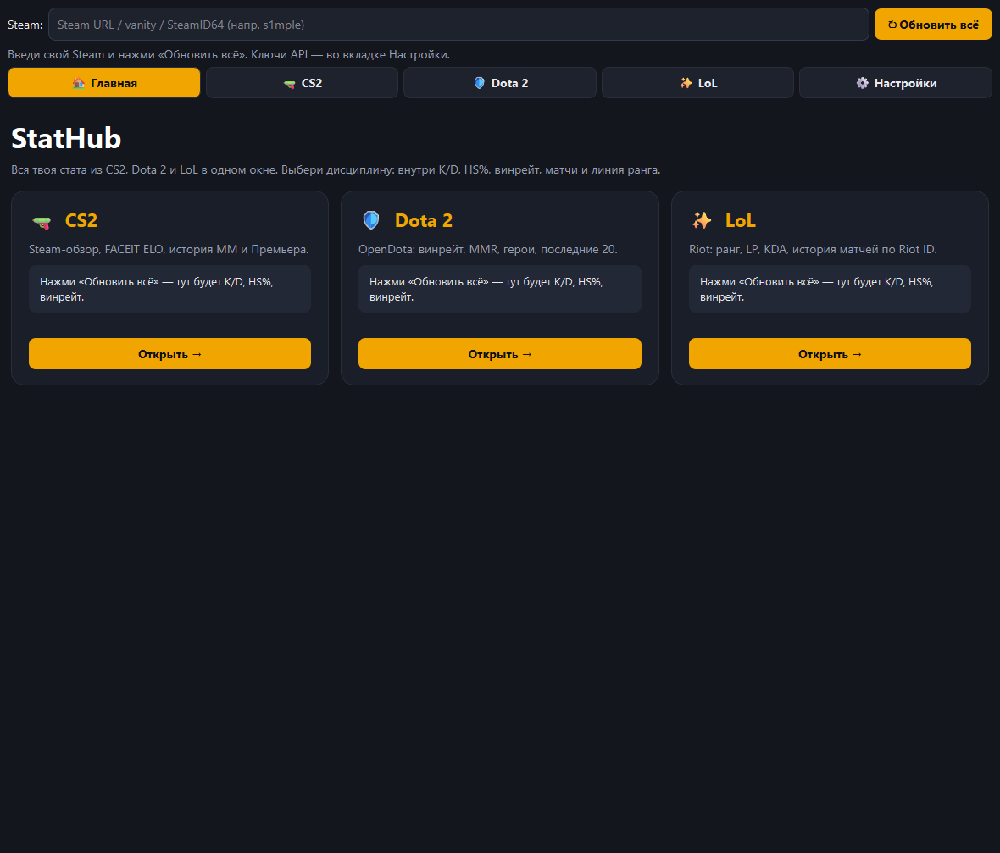

# StatHub — стата CS2, Dota 2 и LoL в одном окне

> Desktop app (Python + PySide6) that pulls player stats from Steam, FACEIT, OpenDota and Riot APIs.



Вводишь свой Steam — получаешь K/D, HS%, точность, винрейт, часы, ELO на FACEIT, последние матчи и «линию ранга». Отдельно Dota 2 через OpenDota и League of Legends через Riot API.

## Откуда данные

| игра | API |
|---|---|
| CS2 | Steam Web API (стата, профиль), FACEIT Data API (ELO, матчи), страница GCPD (история ММ/Премьера по cookie) |
| Dota 2 | OpenDota (винрейт, MMR, герои, последние 20 матчей) |
| LoL | Riot API: Riot ID → PUUID → match-v5 |

## Как устроено

```
main.py               — запуск + сплэш
src/api/              — по модулю на каждый сервис
src/ui/main_window.py — интерфейс: главная, вкладки игр, настройки
src/utils/helpers.py  — разбор Steam-ссылок, расчёт K/D, HS%, ADR
config/settings.example.json
```

- понимает любой ввод: ссылку на профиль, vanity или SteamID64
- ошибки API показываются по-человечески (например, если ввёл логин вместо vanity)
- ключи и cookie лежат только локально в `config/settings.json` (он в `.gitignore`), в интерфейсе скрыты как пароль
- какие игры показывать на главной — выбирается в настройках

## Запуск

```bash
python -m venv venv
venv\Scripts\activate
pip install -r requirements.txt
python main.py
```

Ключи: Steam — https://steamcommunity.com/dev/apikey, FACEIT — https://developers.faceit.com, Riot — https://developer.riotgames.com. Вставить во вкладке «Настройки».

---
Сделано [Quorvox_team](https://github.com/Quorvox)
